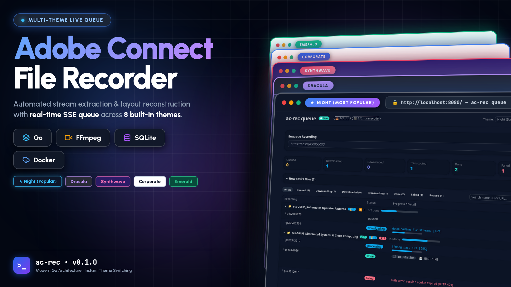
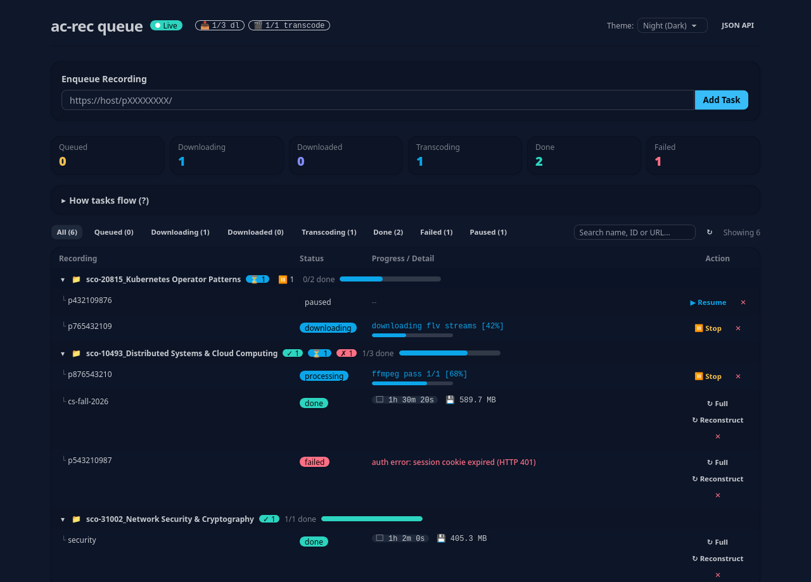
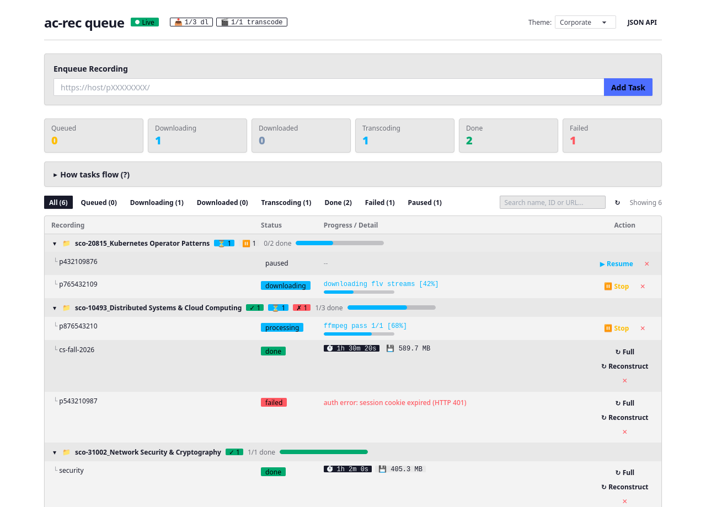
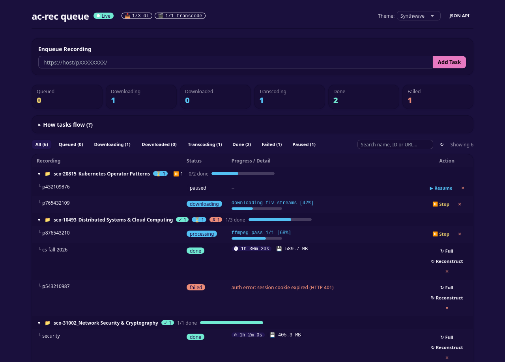
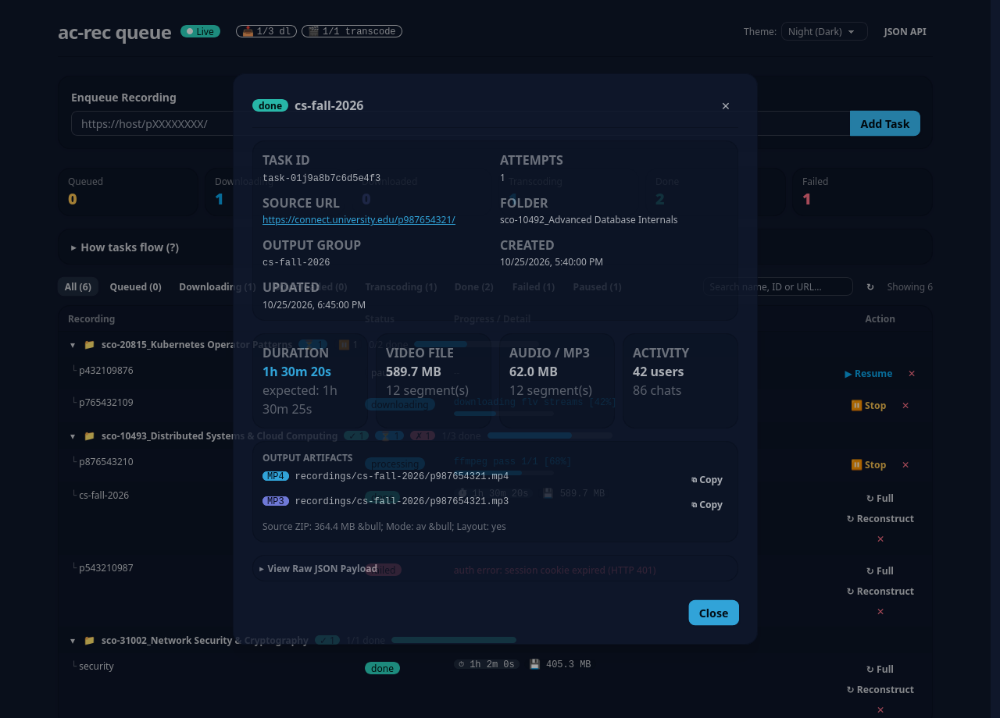
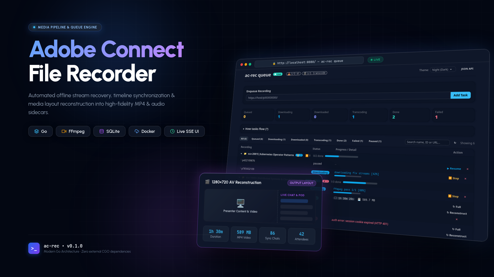

# AdobeConnect-file-recorder



ابزار دانلود و بازسازی جلسات ضبط‌شده آفلاین Adobe Connect با فرمت **Standard AV** (عصر FLV/VP6) — همان ضبط‌های قدیمی که دکمه دانلود مستقیم یا نسخه MP4 ندارند — در قالب یک فایل MP4 یکپارچه همراه با صدای تعبیه‌شده و فایل‌های جانبی.

خروجی پیش‌فرض یک **ویدیو با رزولوشن 1280×720 شبیه‌سازی‌شده بر اساس چیدمان کلاس** است: محتوای ارائه‌شده در سمت چپ، همراه با لیست حاضرین و تاریخچه چت (هماهنگ با زمان ویدیو) که به صورت زیرنویس در یک نوار کناری (Sidebar) با عرض ۳۲۰ پیکسل در سمت راست حک (Burn-in) می‌شود. ارتفاع این نوار دقیقاً بر ارتفاع ویدیوی اصلی منطبق است.

مستندات تحقیق و معماری: [`docs/ADOBE_CONNECT_OFFLINE_RECORDING_PLAN.md`](docs/ADOBE_CONNECT_OFFLINE_RECORDING_PLAN.md)

## پیش‌نیازها

- گو (Go ≥ 1.22) (تنها جهت بیلد)
- ابزارهای `ffmpeg` و `ffprobe` در PATH سیستم

## بیلد

```sh
go build -o bin/ac-rec ./cmd/ac-rec
go test ./...
```

## نحوه استفاده

```sh
# پایپ‌لاین کامل: دانلود فایل آرشیو + بازسازی و تبدیل
bin/ac-rec download 'https://connect.example.com/meeting12345678/' --session '<BREEZESESSION>'

# همان عملیات با ورود خودکار از طریق فایل .env (بدون نیاز به --session)
bin/ac-rec download 'https://connect.example.com/meeting12345678/'

# بازسازی آفلاین از روی فایل ZIP دانلود شده
bin/ac-rec reconstruct ~/Downloads/meeting12345678.zip
```

### نحوه دریافت کوکی Session:
وارد کلاس شوید → ابزار مرورگر (DevTools → Network) → روی یکی از درخواست‌ها کلیک کنید → Request Headers → مقدار `Cookie: BREEZESESSION=…` را کپی کرده و با فلگ `--session` ارسال کنید؛ یا کوکی‌های دلخواه دیگر را با `--cookie Name=Value` (قابل تکرار) مشخص کنید.

همچنین می‌توانید اطلاعات کاربری را در فایل `.env` قرار دهید (نمونه در [`.env.example`](.env.example)):

```sh
AC_USERNAME=you@example.com
AC_PASSWORD=secret
```

(`USERNAME=` و `PASSWORD=` نیز پشتیبانی می‌شوند و فایل در `.gitignore` قرار دارد). در صورتی که `--session` مشخص نشده باشد و فایل `.env` موجود باشد، لاگین به صورت خودکار از طریق `/api/xml?action=login` انجام شده و سشن دریافت می‌شود.

خروجی در مسیر `./recordings/<recording-title>/` ذخیره می‌گردد (در دستور `download`؛ در دستور `serve` ضبط‌ها بر اساس پوشه‌ای که در سرور Adobe Connect دارند دسته‌بندی می‌شوند — به شکل `./recordings/<folder-id>_<folder-name>/<recording-title>/` به همراه یک فایل `folder.json` که شناسه عددی را به نام فارسی/انگلیسی پوشه نگاشت می‌کند؛ موارد بدون پوشه در `_unfiled/` ذخیره می‌شوند):

| فایل | محتوا |
|---|---|
| `recording.mp4` | ویدیوی H.264 + AAC با چیدمان 1280×720 (محتوای ارائه + سایدبار حاضرین و چت) |
| `recording.mp3` | خروجی فقط صوتی (با استفاده از فلگ `--mp3`) |
| `chat_log.txt` | گزارش کامل متن چت همراه با برچسب زمان با فرمت `HH:MM:SS` |
| `attendees.txt` | فهرست اسامی یکتای حاضرین در جلسه |
| `metadata.json` | اطلاعات فنی شامل مدت زمان، تعداد قطعات استریم و هشدارها |

### فلگ‌های کاربردی:
- `--raw`: ذخیره خروجی تمام‌صفحه با رزولوشن اصلی منبع بدون اعمال لایوت و سایدبار
- `--mp3`: استخراج نسخه فقط‌صوتی در قالب فایل `recording.mp3`
- `--resolution 480p|720p|1080p`: تنظیم رزولوشن خروجی (پیش‌فرض: 720p)
- `--fps`: تنظیم نرخ فریم (پیش‌فرض: 25)
- `--preset` و `--crf`: سرعت انکود و میزان فشرده‌سازی x264 — برای مثال `--fps 12 --preset ultrafast` سرعت رندر جلسات اشتراک صفحه را تا حدود ۴ برابر افزایش می‌دهد
- سایر فلگ‌ها شامل `--name`، `--out`، `--overwrite`، `--session` و `--cookie` که با اجرای `ac-rec help` در دسترس هستند.

## نحوه کارکرد (Architecture)

1. استخراج نشانی فایل فشرده آرشیو `…/<id>/output/<id>.zip?download=zip` از آدرس ضبط.
2. دانلود آرشیو با کوکی سشن (همراه با قابلیت تلاش مجدد، اعتبارسنجی هدر جادویی ZIP و جلوگیری از ذخیره پاسخ‌های خطای لاگین HTML).
3. تجزیه فایل ساختار جلسه `mainstream.xml` و استخراج قطعات زمانی استریم‌ها (`streamRemoved` و `__stop__`).
4. پردازش تک‌مرحله‌ای با FFmpeg: ایجاد بوم 720p + هم‌پوشانی ویدیوی اشتراکی + زیرنویس‌های ASS چت و حاضرین؛ تبدیل کدک‌های قدیمی VP6/Nellymoser به H.264/AAC. بخش‌های فاقد تصویر با فریم مشکی جایگزین شده و سگمنت‌های صوتی در موقعیت دقیق زمانی (`adelay` + `amix`) قرار گرفته و پدینگ می‌شوند تا هیچ‌گونه ناهماهنگی صوتی و تصویری (Audio Drift) به وجود نیاید.
5. اعتبارسنجی مدت‌زمان ویدیو با تایم‌لاین واقعی و ارائه گزارش کامل.

موارد صرف‌نظرشده در حال حاضر: اتوماسیون کامل لاگین با مرورگر، جابه‌جایی دینامیک پنجره‌ها، تصویر در تصویر وب‌کم (PiP) و مسیر بهینه‌سازی فایل‌های Enhanced-AV. (در صورت نیاز به ضبط خاص اضافه خواهد شد).

## سرویس صف پس‌زمینه (Queue Service)

دستور `ac-rec serve` کارگران پردازش (Workers) را به همراه یک صفحه مانیتورینگ تحت وب و API ساده اجرا می‌کند:

```sh
cp .env.example .env   # تنظیم پورت، تعداد ورکرها، مشخصات لاگین و غیره
bin/ac-rec serve [--env .env]

curl -X POST localhost:8080/api/tasks \
  -H 'Content-Type: application/json' \
  -d '{"url":"https://connect.example.com/meeting12345678/"}'
```

داشبورد وضعیت در نشانی `http://localhost:8080/` و وضعیت صف در اندپوینت‌های `GET /api/tasks` و `GET /api/tasks/{id}` در دسترس است. تنظیمات در `.env` شامل: `PORT`، `DATA_DIR` (تنظیم `REPOSITORY_TYPE=file|sqlite` نوع پایگاه داده را مشخص می‌کند؛ انتخاب `sqlite` فایل `queue.json` قدیمی را به صورت خودکار ایمپورت می‌کند)، `OUT_DIR`، `MAX_DOWNLOAD_WORKERS`، `MAX_RECONSTRUCT_WORKERS`، مشخصات ورود `AC_USERNAME`/`AC_PASSWORD`، پارامترهای پیش‌فرض رندر (`DEFAULT_RESOLUTION`, `DEFAULT_FPS`, `DEFAULT_PRESET`, `DEFAULT_CRF`, `EXPORT_MP3`) و `RETRY_COUNT`.

اجرا با داکر:

```sh
docker compose up --build
```

### رابط کاربری داشبورد تحت وب

<p align="center">
  
</p>

<table align="center" width="100%">
  <tr>
    <td width="50%"></td>
    <td width="50%"></td>
  </tr>
  <tr>
    <td align="center"><em>تم روشن Corporate</em></td>
    <td align="center"><em>تم نئونی Synthwave</em></td>
  </tr>
  <tr>
    <td colspan="2"></td>
  </tr>
  <tr>
    <td colspan="2" align="center"><em>مودال بررسی جزئیات پردازش، خروجی‌های مدیا، مدت‌زمان و خطاها</em></td>
  </tr>
</table>

### معماری و چیدمان خروجی بازسازی‌شده

<p align="center">
  
</p>
