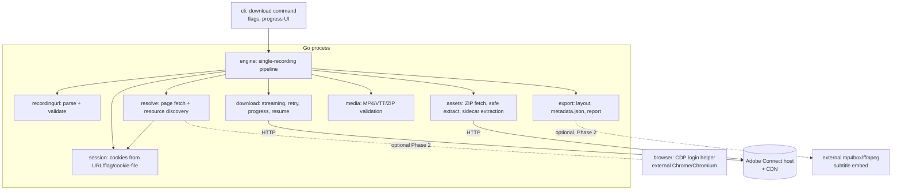

# Adobe Connect Offline Recording Downloader — Technical Plan (Go)

Status: **PLAN ONLY — not implemented.** Awaiting user review.
Target language: Go. Repository: `AdobeConnect-file-recorder` (currently **empty** — greenfield).

**Target environment (confirmed by user, 2026-10-12):**

| Question | Answer |
|---|---|
| Example recording URL | `https://webinar5.um.ac.ir/p15rdeovw4ge/` — custom-domain deployment (likely on-prem Adobe Connect; exact hosting to be confirmed by E1) |
| Login | Simple username/password form (no SSO redirect) |
| Desired output | MP4; captions **embedded in the MP4** *(interpretation of "mp4" — to be confirmed; if sidecar `.vtt` is acceptable the embed step becomes optional behind one flag)* |
| Recording duration | 60–120 min (≈0.5–2 GB per recording at typical bitrates) |
| Output name | The recording's page title (fetched from the page, sanitized) |
| Recording age | **Very old; no download option at all.** Likely **Standard AV** (FLV-chunk era) or a pre-Enhanced-AV room. This makes Approach A's premise unverified for this instance and elevates the Phase 0 experiment (and possibly reconstruction, Phase 3) in priority. |

---

## 1. Executive Summary

Goal: let a legitimate viewer save an Adobe Connect recording they are authorized to watch as an offline-playable file (MP4 + sidecars) using a Go CLI.

Research shows modern Adobe Connect recordings (v12+, "Enhanced AV") are stored by the server **natively as a single MP4** with **no DRM**: the browser player simply fetches a signed MP4 URL and buffers it ([verified — official Adobe blog + two independent open-source implementations, see §3]). The dominant strategy is therefore **Approach A: direct media extraction** — resolve the authorized MP4 URL from the recording page, stream it to disk, and preserve captions/chat/transcripts/attachments from the recording's raw-asset ZIP as sidecar files.

Approach B (raw FLV reconstruction) exists and is proven by a reference project, but it is expensive, lossy in layout fidelity, and only needed for old "Standard AV" recordings. Approach C (browser capture) is a last resort. Both are deferred behind explicit fallback criteria (§6).

The first deliverable of the implementation must be a **half-day feasibility experiment** (§16, Phase 0) proving that direct MP4 extraction works against the user's actual Adobe Connect instance before any code beyond the experiment harness is committed.

Because the target repository is empty, this plan also defines the project's initial structure, conventions, and test layout. There is no existing code, CLI, or infrastructure to reuse — that is stated explicitly rather than assumed (§4).

---

## 2. Problem Statement and Constraints

### 2.1 Problem

Adobe Connect recordings are viewable in a browser but, depending on account policy, offer no "Download" button. A user with legitimate view access wants an offline copy (flight/travel, poor connectivity, archival). Today the only guaranteed method the user has is "play it in a browser."

### 2.2 Constraints

| Constraint | Consequence for design |
|---|---|
| Browser playback is the user's current working mechanism | A real browser may be needed to **establish an authorized session** (cookies), but screen capture is *not* assumed necessary (§6). |
| Written in Go | Browser automation and media processing must be orchestrated from Go via external processes or minimal, justified deps. |
| Only resources the user is authorized to access | No credential stuffing, no access-control bypass, no DRM circumvention. We replay the user's own session. |
| Recordings vary by version/config | Standard AV (FLV chunks) vs Enhanced AV (MP4); hosted vs on-prem; SSO vs direct login. Design must detect, not assume. |
| Signed URLs expire | Media URLs must be resolved immediately before use and refreshable on 403 (§12). |
| Planning only | No application code, deps, or binaries are created by this document. |

---

## 3. Research Findings and Source Links

Evidence labels: **[V]** verified from fetched source/docs, **[I]** inferred, **[U]** unknown/needs experiment.

### 3.1 How Adobe Connect recordings play in a browser

- The modern recording viewer is a React SPA with a custom HTML5 player. It fetches a URL pointing at an MP4 and progressively buffers it. There is **no DRM, no Widevine, no chunk encryption** — downloading the full MP4 is equivalent to what the player buffers. **[V]** — blog with DevTools screenshots: https://keanuc.net/blog/creating-the-world-s-best-adobe-connect-recording-downloader-for-fun/ (author of AdobeConnectDL).
- The page HTML (classic, non-React recording page) embeds JavaScript variables consumed by tooling **[V]** (regexes in `internal/downloader/http.go` of AdobeConnectDL, fetched 2026-10-12):
  - `var casRecordingURL = 'https://…'` — a **signed CAS endpoint that redirects to the actual MP4** (example target seen in logs: `https://cdn1.adobeconnect.com/static/recordings/…?key=…&param1=…&ts=…&sign=…`).
  - `var casCaptionURL = 'https://…'` — signed caption endpoint; the tool appends `name=<file>.vtt`.
  - `var transcriptFilename = '…​.vtt'` — the captions filename (JS `\x20`-escaped).
  - `<video src="…">` and `<track src="…">` tags also occur. **[V]**
- The page requires a `BREEZESESSION` cookie for private recordings; the session token is passed in the URL as `?session=…` by the player. **[V]** (AdobeConnectDL sets `BREEZESESSION` from the query param; AdobeConnectDownloader does the same in `WebManager.GetSessionCookieFrom`.)
- Signed URLs **expire**; AdobeConnectDL explicitly re-fetches the page to refresh the caption URL before use ("CAS URLs expire, so refresh the page immediately before using one"). **[V]**

### 3.2 Direct MP4 availability (official Adobe position)

- Adobe Connect Support Blog (official), 2022-09-30: *"An added bonus with Enhanced AV in Adobe Connect v12 is meeting recordings are now recorded directly to MP4 format… the recording is immediately available for download and offline distribution."* **[V]**
  - URL: https://blogs.connectusers.com/connectsupport/download-enhanced-av-recordings-using-the-xml-api/
  - Detection: `sco-info` XML-API response contains `<cas-delivered-recording>true</cas-delivered-recording>` for Enhanced AV recordings (Standard AV recordings are **not** immediately available as MP4). **[V]**
  - Download URL: append **`/?download=true&name=<name>.mp4`** to the recording's `url-path`, e.g. `https://[domain]/preuyr767ghu/?download=true&name=rec.mp4`. **[V]** (documented via XML-API; **[U]** whether it works with a viewer-only browser session cookie — experiment E2.)
- The blog also documents the XML API actions involved (`sco-contents` with `filter-icon=archive`, `sco-info`) — these require API credentials (admin/integration), so the CLI must not *depend* on them. **[V]**
- helpx.adobe.com blocked automated fetching (HTTP 403); official docs were not inspected beyond the blog above. **[U]** for finer doc details.

### 3.3 Raw asset ZIP ("download the ZIP")

Both reference tools use the same undocumented-but-stable URL patterns **[V]** (source of AdobeConnectDL and AdobeConnectDownloader fetched 2026-10-12):

| Resource | URL pattern | Notes |
|---|---|---|
| Recording output ZIP | `https://<host>/<recording-id>/output/<recording-id>.zip?download=zip` | Contains raw assets (see below). |
| Source assets ZIP | `https://<host>/<recording-id>/source/<recording-id>.zip?download=zip` | Used by AdobeConnectDownloader as "assets method 1". Contents **[U]** in detail. |
| Page with session | `https://<host>/<recording-id>/?session=<token>&proto=true` | C# tool's page URL form. |

ZIP contents (verified via AdobeConnectDL `testdata/` fixtures and extraction code):

- `mainstream.xml` — **[V]** (C# tool reads it as its timeline source): `<Message>` event stream; `streamRemoved` events carry `<Array><Object><startTime>…`, `<streamName><![CDATA[/cameraVoip_…|/screenshare_…]]></streamName>`; used to derive per-FLV segment start/end times. The C# code contains a commented-out line showing older versions used `indexstream.xml` for the same purpose.
- `indexstream.xml` — **[V]** (fixture `testdata/lecture1/indexstream.xml`): begins `<Signature>FLV</Signature>`, `onMetaData` with `attendees` (`anonymousName` ↔ `fullName`/`first-name`/`last-name`), then `playEvent` / timeline messages. Used by AdobeConnectDL to map anonymized caption speakers to real names.
- `transcriptstream.xml` — **[V]** (fixture + `extractChatLog`): chat messages (`iconType=chat`, `label`, `name`, `time` in ms) and stage events ("has joined the stage").
- `*.vtt` — closed captions, sometimes inside the ZIP. **[V]**
- `fttitle*.xml`, `ftfileshare*.xml` — pod title/share metadata; web links (`extractWebLinks`) and document links (`extractDocumentLinks`, `<theUrl><![CDATA[/_a7/…]>` in C# tool). **[V]**
- FLV chunks (`cameraVoip_*.flv`, `screenshare_*.flv`, …) in the *source* layout; the output ZIP in the MP4 era may or may not contain all FLVs — **[U]**, experiment E3.
- `edit.xml` — **[U]**. No evidence found in either codebase or the official blog. Must not be designed against; record whatever the experiment finds. (Task brief listed it "where applicable" — currently it is not applicable to any verified code path.)

Caveats on ZIP sufficiency **[V]** (from AdobeConnectDownloader README, Persian/English): the ZIP+FLV reconstruction path **cannot reproduce whiteboard/annotated-pod content as video** — only audio + downloaded PDF; and only **one** presenter's screen/camera can be reconstructed. The AdobeConnectDL author likewise abandoned reconstruction ("combining several randomly ordered FLV files into a single mp4 is… not fun").

### 3.4 Authentication, cookies, signed URLs, permissions

- `?session=<token>` → cookie `BREEZESESSION=<token>` is the whole auth mechanism for both media and ZIP URLs. **[V]** (both tools).
- 403 = expired/used token or insufficient permission; 404/HTML-body = recording or resource unavailable; a `text/html` response where video/ZIP is expected = auth page, not content. **[V]** (AdobeConnectDL validates exactly these cases).
- `HEAD` returning `Content-Type: application/zip` is used by the C# tool to pre-validate access. **[V]**
- Adobe's own download button for Enhanced AV requires only normal recording-view permission (the blog describes end-user download). **[I]**
- SSO-protected instances require a real interactive login; both tools solve this by having the *user log in in a real browser* and carrying the resulting session into the tool (C# tool: "External Login Browser → login → Collect Data"; Go tool: copy the `?session=` URL from the address bar). **[V]**

### 3.5 Reference project evaluations

#### 3.5.1 AdobeConnectDL — https://github.com/keanucz/AdobeConnectDL **[V]**

- **Language/architecture:** Go 1.25, Cobra CLI (`download`, `version`), packages `internal/downloader` (core), `internal/mp4box` (bundled GPAC MP4Box binaries for subtitle embedding), `internal/version`. Structured logging via `charmbracelet/log`. MIT license.
- **Resource discovery:** fetch recording page once with `BREEZESESSION` cookie; regex + `golang.org/x/net/html` tokenizer extract `casRecordingURL`, `<video src>`, `casCaptionURL`, `transcriptFilename`; prefer CAS URL over `<video>` tag.
- **What it downloads:** MP4 rendition (direct, streamed), raw ZIP (sidecars), VTT captions (from ZIP or signed caption endpoint), linked documents (`/_a7/…` URLs), links list, metadata.json.
- **Auth:** session token from URL/flag → cookie; no credential login; clear error text explaining how to obtain `?session=`.
- **Captions/chat/transcripts:** VTT cleaned (anonymous speakers → real names via `indexstream.xml` mapping), transcript.txt generated from VTT, chat log from `transcriptstream.xml`, documents downloaded.
- **Not reconstruction, not capture:** canonical output is the server's MP4 + MP4Box-subtitled copy. Embeds VTT with bundled MP4Box (16 MB binary vs 134 MB with ffmpeg — the author's measured trade-off).
- **Robustness:** concurrent worker pool (12 workers), temp-file + rename, HTML-sniff/ZIP-magic/min-size validation, CAS URL refresh before caption use, `ErrAuthRequired`/`ErrNotFound`/`ErrInvalidZip` sentinel errors.
- **Reusable design ideas:** page-info extraction set, cookie merge rules, validation strategy, ZIP sidecar extraction, sentinel-error taxonomy, temp-then-rename, progress-reader. **Limitation:** no retry/backoff, no resume, no cancellation ergonomics in core, no browser-assisted login, tightly coupled to hosted-Adobe URL shapes, MIT license allows reuse with attribution.

#### 3.5.2 AdobeConnectDownloader — https://github.com/HosseinShams00/AdobeConnectDownloader **[V]**

- **Language/architecture:** C# WinForms GUI (.NET), Windows-centric, GPL-3.0 (derivatives must be GPL — **do not copy code**; design patterns only).
- **Resource discovery:** download output ZIP → extract → read `mainstream.xml` → regex/XML parse of stream timeline events → per-segment FLV list; extra files from `<theUrl>` entries; optional `source/{id}.zip`; PDF pages as `layout.xml` + `N.swf` → `swfrender` → PDF.
- **What it downloads:** ZIP + referenced FLVs + files + PDFs. **No direct MP4 path** (predates/ignores Enhanced AV renditions).
- **Auth:** `BREEZESESSION` from URL; "External Login Browser" collects cookies after a real interactive login — the key reusable idea for SSO.
- **Reconstruction:** FFmpeg-driven: concat FLV segments, synthesize gap-filling still video, extract audio, optionally overlay webcam next to screen share. Slow (20–40 min of processing per 2-hour meeting per README) and lossy.
- **Limitations:** one presenter's streams only; whiteboard-only sessions produce no video; no captions/chat export; GUI-only; requires bundled `Adobe.Connect.Downloader.Tools.rar` (ffmpeg, swfrender).

#### 3.5.3 Other projects referenced by the AdobeConnectDL author (not inspected in depth) **[I]**
`soroushamdg/acd`, `MRT-77/AdobeConnectRecord`, `Franck-Dernoncourt/adobe-connect-video-downloader`, `sina-rostami/Adobe-Connect-Meetings-Downloader` — described in the blog as ~4 years old, GUI-heavy or awkward; treat as prior art, not design inputs.

### 3.6 Summary of what is verified vs assumed

| Capability | Status |
|---|---|
| Enhanced AV recordings expose a plain MP4, no DRM | **Verified** (official blog + DevTools evidence + working tool) |
| `casRecordingURL`/`casCaptionURL`/`transcriptFilename` in page HTML | **Verified** in AdobeConnectDL code & live logs; **assumed** present on all deployments (experiment E1) |
| `/output/<id>.zip?download=zip` raw assets | **Verified** in both tools |
| `?download=true&name=x.mp4` direct download | **Verified** as documented; **unverified** with viewer-only session (experiment E2) |
| `BREEZESESSION` cookie auth | **Verified** in both tools |
| ZIP contains everything needed to *reconstruct* full video | **Disproved** as a general claim (whiteboard/pod layout not reconstructable; single presenter only) |
| `edit.xml` role | **Unknown** |
| CDN supports HTTP Range resume | **Unknown** (experiment E4) |

---

## 4. Existing Project Architecture Assessment

Repository path: `./`.

**Finding: the directory is completely empty** (verified with a full recursive listing including hidden files on 2026-10-12). There is no application code, no `go.mod`, no tests, no CI, no docs, no git repository. Therefore:

- There are **no existing CLI commands, interfaces, packages, DI patterns, HTTP clients, browser automation, media processing, logging, or configuration mechanisms to reuse.** Anything stated about "existing conventions" would be invented; nothing is invented here.
- The architecture below is a *greenfield proposal*, deliberately modeled on conventions proven by the reference Go project (Cobra-style command layout, `internal/` packages, sentinel errors, stdlib-first HTTP) while fixing its weaknesses (no retries, no cancellation design, no test seam for auth).
- Consequence for the roadmap: Phase 1 includes project bootstrap (`go.mod`, lint, CI) as an explicit deliverable.

---

## 5. Comparison of Implementation Approaches

### Approach A — Direct media extraction (preferred)

Flow: authorized page fetch → discover signed MP4 URL → stream MP4 to disk → fetch ZIP + captions as sidecars → validate.

| Pros | Cons |
|---|---|
| Original quality, no re-encoding; server-authored rendition | MP4 rendition may not exist for **Standard AV** (pre-v12) recordings **[V: blog]** |
| Fast: download ≈ network speed (reference tool: ~328 MB in ~17 s batch logs) | Signed URLs expire → refresh logic required **[V]** |
| Trivially portable: pure `net/http` + filesystem | Page-HTML parsing is brittle against player updates **[I]** |
| Preserves exact player-visible content | Some recordings may only exist as HLS **[U]** — experiment E1 |

### Approach B — Raw asset download + reconstruction

Flow: ZIP/`source` ZIP → parse `mainstream.xml` timeline → FFmpeg concat FLV segments + gap fill + audio mux (+ optional webcam overlay).

| Pros | Cons |
|---|---|
| Works for recordings without MP4 rendition **[I]** | FLV chunks are unordered per segment; requires heavy FFmpeg orchestration **[V]** |
| Independent of the modern player | Slow (20–40 min per 2 h meeting) **[V: README]** |
| Extracts rich metadata (chat, attendees, links) | Lossy: whiteboard/pods not representable; single presenter only **[V]** |
|  | PDF-as-video would require swfrender/SWF page rendering — legacy dependency chain |

### Approach C — Browser-based capture

Flow: drive a real browser to play the recording; capture the `<video>` element's frames/audio (e.g., via CDP screencast or virtual display + ffmpeg/x11grab).

| Pros | Cons |
|---|---|
| Works for anything the user can *play* — the ultimate fallback | Real-time speed: a 2 h recording takes 2 h |
| No dependency on internal URL shapes | Quality loss (re-encode), aspect/window artifacts |
|  | Fragile: stalls, seeking, popups, session expiry mid-play |
|  | OS-specific capture surfaces break portability; pure-Go capture of a browser's AV output is not realistic |
|  | Long-run supervision, crash recovery, A/V sync all become our problem |

### Fallback criteria (explicit)

1. Run Approach A probe (E1/E2). If usable MP4 URL discovered → **A**.
2. If no MP4 but raw ZIP contains FLV streams per `mainstream.xml` → **B** (post-MVP, Phase 3).
3. If neither (or user must watch something the API can't express) → document **C** as a manual fallback; implement only if a real need is demonstrated (Phase 4, optional).
4. Never silently degrade: report *why* a recording can't be A/B-handled.

---

## 6. Recommended Approach and Rationale

> **UPDATE after E1 probe (2026-10-12):** the live netlog experiment (§3/§16) proved the target instance (`webinar5.um.ac.ir`) serves a **Standard AV** recording: VP6-over-WASM decode, content streamed via WebSocket `wss://…:1443/`, **no MP4 rendition exists**. Therefore, **for this instance the primary track is Approach B (raw ZIP/FLV download + FFmpeg reconstruction)**, and the Phase 1 MVP is re-scoped accordingly (B-specific detail: §5 table, C# reference pipeline in §3.5.2 is the proven model). Approach A is retained as the fast path for any Enhanced-AV instance and as the pattern for the `resolve`/`download` packages. The rest of this section explains why A was preferred *when an MP4 exists* — which is no longer the case here.

**Original recommendation (for Enhanced-AV targets): Approach A as the MVP core, with the raw-ZIP sidecar pipeline (metadata/chat/captions/documents) alongside it; B and C behind fallback criteria.**

Rationale:

1. Evidence is strongest for A: an official Adobe statement that Enhanced AV recordings *are* MP4s with a documented download URL pattern, plus two working independent implementations (one consuming the same signed CDN URL the browser player uses).
2. A subsumes the user's requirement — "what plays in the browser" *is* (for Enhanced AV) the MP4. The player itself downloads exactly this file **[V]**.
3. B is strictly worse when A works and only marginally better than nothing when it doesn't (incomplete layouts, single presenter). Its only unique value is metadata extraction — which A+ZIP already provides.
4. C's cost (real-time, fragile, OS-specific) is unjustified while A covers Enhanced AV. It stays the documented escape hatch.
5. "Browser-only playback" constraint is honored where it matters: a real browser (or the user's exported session) is used to **establish authorization** (§10); screen capture is not.

Alternative considered and rejected for MVP: *capture-first* design (treat the browser as the only mechanism). Rejected because it sacrifices quality and speed for a problem that verified evidence says is a plain file download.

---

## 7. Proposed Go Architecture and Diagrams

Design principles: stdlib-first (`net/http`, `context`, `archive/zip`, `io`, `encoding/json`), streaming I/O everywhere, one interface per *actual* seam (clock/HTTP/browser), no premature packages. Errors are typed sentinels; every network call is context-bound.



```mermaid
sequenceDiagram
    participant U as User
    participant CLI as CLI (Go)
    participant B as Browser (user's)
    participant AC as Adobe Connect host
    participant CDN as CDN (signed URL)

    U->>B: Log in, open recording, copy URL (?session=…)
    U->>CLI: ac-rec download "<url>" -o out/
    CLI->>CLI: Parse/validate URL, derive BREEZESESSION
    par
        CLI->>AC: GET /<id>/?session=… (cookie)
        AC-->>CLI: HTML (casRecordingURL, transcriptFilename, title)
    and
        CLI->>AC: GET /<id>/output/<id>.zip?download=zip
        AC-->>CLI: ZIP (chat, index, captions, docs refs)
    end
    CLI->>CDN: GET casRecordingURL (follow redirect, cookie only same-host)
    CDN-->>CLI: 302 → MP4 URL (signed, expiring)
    CLI->>CDN: stream MP4 → .part file (progress, ctx cancel)
    CLI->>AC: GET captions VTT (refresh page if 403 → new signed URL)
    CLI->>CLI: Validate (ftyp magic, size==Content-Length, VTT header)
    CLI->>CLI: Extract sidecars (chat_log.txt, transcript, links, docs index)
    CLI->>AC: download documents (bounded pool)
    CLI->>CLI: atomic rename .part → final; metadata.json; report
    CLI-->>U: Summary + warnings (e.g., "no MP4 rendition — Standard AV?")
```

### Package structure (proposed)

```
AdobeConnect-file-recorder/
├── go.mod                        module github.com/iman-langaran/AdobeConnect-file-recorder
├── cmd/
│   └── ac-rec/
│       └── main.go               wiring only; calls internal/cli
├── internal/
│   ├── cli/                      command(s), flag parsing, progress rendering, exit codes
│   ├── recordingurl/             URL parse/validate/sanitize (pure)
│   ├── session/                  cookie/session assembly; cookie-file read/write (0600)
│   ├── resolve/                  recording page fetch + resource discovery (MP4/CAS, VTT, ZIP, title)
│   ├── download/                 streaming downloader: retry, backoff, resume, progress, size caps
│   ├── assets/                   ZIP fetch + zip-slip-safe extract + sidecar extraction
│   │   │                           (chat, attendee map, links, docs, captions)
│   ├── media/                    validators: MP4 ftyp/mvhd probe, VTT header, ZIP magic, size checks
│   ├── export/                   output directory layout, metadata.json, final report
│   ├── engine/                   per-recording pipeline orchestration (ties the above together)
│   └── browser/                  (Phase 2 contingency) CDP login helper — demoted; direct form login is primary now
├── testdata/                     fixture pages, XML, VTT, tiny MP4/ZIP (see §14)
└── docs/
    └── ADOBE_CONNECT_OFFLINE_RECORDING_PLAN.md
```

CLI surface (MVP — stdlib `flag`, single verb; rationale below):

```
ac-rec download <recording-url> [-o DIR] [--session TOKEN] [--cookies FILE]
               [--no-zip] [--workers N] [--timeout D] [-v]
ac-rec -version
```

**Decision:** MVP uses stdlib `flag` + one command rather than Cobra. Rationale: one verb, zero deps, smaller binary; the ladder favors stdlib. *Alternative considered:* Cobra (as in AdobeConnectDL) — adopt it in Phase 2 if subcommands multiply (`resume`, `probe`, `capture`). *(ponytail: ceiling = flag grows >6 options or >2 commands; upgrade path = spf13/cobra.)*

Dependencies (proposed, all justified):

| Dep | Why | Alternative rejected |
|---|---|---|
| `golang.org/x/net/html` | Robust `<video>/<track>/<title>` extraction from recording pages (regex-HTML is how brittle tools die) | pure regex — kept as *fallback* extraction after tokenizer, per reference |
| *(none else for MVP)* | logging: stdlib `log/slog`; JSON+text | charmbracelet/log — nice, not needed |
| External `mp4box` **optional** Phase 2 | subtitle embedding | bundling binaries (13–33 MB per platform) — rejected for MVP |

### Go ↔ external-tool boundaries

- **Browser (Phase 2):** Go speaks CDP over WebSocket to a user-installed Chrome/Chromium (`--remote-debugging-port`) *or* launches one headful; Go never embeds a browser engine. Testable via a fake CDP server; real-browser tests behind a build tag.
- **Media tools (Phase 2, optional):** `exec.CommandContext` against user-installed `mp4box` (or `ffmpeg`) discovered on `PATH`/`--tool-path`. Never re-encode in MVP; embedding is a mux-only operation. Tests stub the tool with a shell script fixture.
- Everything else (HTTP, ZIP, MP4 probing) is pure Go — no external processes.

---

## 8. Component Responsibilities and Lifecycle

For each component: responsibility → inputs/outputs → deps → interactions → location → errors/lifecycle.

1. **`recordingurl`** — parse & validate the recording URL.
   - In: raw string. Out: `RecordingURL{Scheme, Host, ID, BaseURL, SessionHint}`.
   - Pure function; no I/O, no deps. Rejects: non-http(s), missing host/ID, userinfo-in-URL, control chars. Normalizes missing scheme. Flags IP-literal hosts for logging (SSRF posture, §13).
   - Errors: `ErrInvalidURL`. Lifecycle: none.
2. **`session`** — assemble the cookie jar for one recording.
   - In: `RecordingURL`, `--session`, `--cookies` file (Netscape format). Out: `*cookiejar.Jar` (stdlib `net/http/cookiejar`).
   - Deps: stdlib. Precedence: `--cookies` file > `--session` flag > `?session=` from URL. Cookie files written 0600; values never logged (redact helper).
   - Errors: `ErrNoSession` (with actionable message copied from the reference tool's excellent UX: how to copy `?session=` from the browser).
3. **`resolve`** — turn an authorized page URL into a resource manifest.
   - In: URL + jar. Out: `Manifest{Title, MP4URL (CAS or direct), VTTURL(s), ZIPURL, Warnings}`.
   - Fetches page (≤2 MiB `LimitReader`), tokenizes HTML, applies the extraction ladder: `casRecordingURL` > `<video src>`; `casCaptionURL`+`transcriptFilename` > `<track src>`; ZIP URL derived from ID (always attempted).
   - Errors: `ErrAuthRequired` (401/403/5xx on page), `ErrNotFound`, `ErrNoMedia` (page OK but nothing discovered → triggers B/C guidance). Must be re-invocable to **refresh** expired signed URLs (§12).
4. **`download`** — bounded-concurrency streaming downloader.
   - In: URL(s), jar, dest path, `ProgressFunc`, opts. Out: file on disk + `Result{Bytes, ContentType, ETag}`.
   - `http.NewRequestWithContext` + `io.Copy` through a 64 KiB buffered writer and a progress reader (proven pattern). Validation *before* committing bytes: HTML-sniff first 4 KiB, magic bytes (`PK\x03\x04` for ZIP, `ftyp` at offset 4 for MP4), `Content-Length` match on completion, min-size floor for video.
   - Retries: ≤3, exponential backoff w/ jitter, retry only GETs that failed with network error/5xx/429; **on 403 for signed URLs → return `ErrSignedURLExpired`** so `engine` can re-resolve and retry once.
   - Resume: if E1 confirms Range support → `Range: bytes=N-` append to `.part`; else restart (documented).
   - Lifecycle: `.part` temp files; rename on success; delete on failure unless `--keep-partial`. ctx cancellation aborts the body read promptly.
5. **`assets`** — raw ZIP acquisition + sidecar extraction.
   - In: ZIP URL + jar, or an existing local ZIP (`--offline-zip`, future). Out: extracted tree + structured `Sidecars{ChatLog, AttendeeMap, Links, Docs[], Captions}`.
   - Safe extraction: reject entries whose `filepath.Join(dest, name)` escapes dest (zip-slip — verified fix pattern in reference), cap entry count/total uncompressed size (zip-bomb), cap per-entry ratio.
   - Parsing: `transcriptstream.xml` (chat), `indexstream.xml` (anonymous→real name map), VTT discovery, `ftfileshare`/`theUrl` doc links. Streaming `bufio.Scanner` over XML (files can be large; no full-file regex on multi-MB content).
   - Errors: `ErrInvalidZip`, `ErrZipUnavailable` (404 — warning, not fatal: MP4 alone is a valid outcome).
6. **`media`** — validators.
   - In: file paths. Out: `Validation{OK, DurationHint, Warnings}`.
   - MP4: `ftyp` box present, sane size, optional `mvhd` duration parse (pure Go, ~40 lines) to compare against page metadata later. VTT: `WEBVTT` header. No ffprobe dependency in MVP.
7. **`export`** — output layout + reporting.
   - In: all artifacts. Out: `<Title>/` directory: `recording.mp4`, `captions.vtt`, `transcript.txt`, `chat_log.txt`, `documents/`, `links.txt`, `raw.zip` (optional), `metadata.json` (source URL **redacted** of `session=`/`sign=`, timestamps, warnings).
   - Sanitized directory names (invalid FS chars → space); refuse non-empty target unless `--overwrite`.
8. **`engine`** — the pipeline.
   - In: one `RecordingURL` + `Options`. Out: `Result` + typed error. Orchestrates §9, owns goroutine lifetimes (`errgroup` w/ ctx), fans out MP4/ZIP/VTT/doc downloads with a shared worker semaphore (`--workers`, default 4 — conservative vs the reference's 12; tune post-E4).
   - Guarantees: every temp file accounted for; partial state recorded in `metadata.json` (`status: partial`) so re-runs skip completed pieces (simple, file-based — no DB).
9. **`cli`** — flags, SIGINT→ctx cancel, progress line (percent + MB, throttled to 10% steps or 500 ms), final summary, exit codes (0 ok, 1 failure, 2 usage, 3 partial-with-warnings).
10. **`browser`** *(Phase 2)* — CDP login helper: attach to or launch Chromium, let the user complete SSO, harvest cookies for the recording host, write cookie file. Nothing in MVP depends on it.

---

## 9. End-to-End Workflow (MVP)

1. Parse/validate URL → `RecordingURL`; assemble session (flag/URL/cookie-file).
2. Concurrently: (a) fetch+parse page → `Manifest`; (b) attempt ZIP download to `raw.zip.part` (URL known a priori from ID).
3. If page fetch says auth-required → fail fast with actionable instructions (no silent retry loops).
4. Start MP4 download from `Manifest.MP4URL` (follow redirect; keep cookies same-host) to `recording.mp4.part`.
5. ZIP done → safe-extract → sidecars: chat log, attendee map, links, docs list → download docs (bounded pool).
6. Captions: prefer VTT from ZIP; else signed caption endpoint (re-resolve page first if the CAS caption URL is present — it expires).
7. Validate MP4 (magic, size, optional duration) and VTT; rename `.part` → final.
8. Write `metadata.json` (redacted), print summary: what succeeded, what was missing (e.g., "no captions", "ZIP unavailable"), where files are.
9. On any fatal step: keep `metadata.json` with `status: partial` + completed artifacts; exit non-zero; next run resumes at file granularity.

---

## 10. Authentication and Browser Integration Strategy

- **Confirmed:** the target deployment uses a plain username/password login form (**no SSO redirect**) — this simplifies Phase 2 considerably.
- **MVP:** cookie replay only. Three supported inputs: `?session=` in the URL (primary, matches both reference tools), `--session` flag, `--cookies` file exported from the browser (Netscape format — every major browser extension can export it; no dependency on a specific one).
- **Direct login (Phase 2, now cheap):** because auth is a simple form, Go can log in programmatically in pure `net/http`: POST the Connect login form, or use Adobe's official XML-API `action=login` (returns session cookies + token). Interface: `--username` + password from prompt or env var (`AC_PASSWORD`); **credentials are used in-process only, never stored or logged.** This replaces the heavier CDP browser-harvest design for this deployment; the CDP helper stays as a documented fallback if the instance later moves to SSO. (The C# tool's "External Login Browser → Collect Data" flow remains the pattern of record for SSO cases.)
- **Never:** store passwords, auto-fill logins, bypass guest restrictions, or defeat "download disabled" policies beyond what the user's own session already permits. If the page is viewable but the ZIP/MP4 denies access, that is a policy signal — surface it, don't route around it.
- Signed media URLs are treated as secrets: redacted from logs/metadata (strip `sign`, `key`, `param1`, `session`).

## 11. Media Processing and Output Format Strategy

- Canonical output: **the server's own `recording.mp4`, byte-identical copy, no transcoding of audio/video** (explicit requirement; also the fastest and highest-quality option).
- Captions (**user wants them in the MP4**): download `captions.vtt`, then mux it into the MP4 as a **soft subtitle track** (`mov_text`) without touching A/V streams — ffmpeg: `-i in.mp4 -i captions.vtt -c copy -c:s mov_text out.mp4`, or MP4Box `-add captions.vtt:lang=en`. Mux-only, so the "no re-encode" guarantee holds. Requires a user-installed `ffmpeg` **or** `mp4box` detected on `PATH`/`--tool-path`; if neither is present, fall back to sidecar `captions.vtt` + prominent warning (never fail the whole download over this). Raw `captions.vtt` is kept as a sidecar either way. *(Assumption: "mp4" answer means embedded; if sidecar is fine, this step is skipped by default and the tool has zero external deps.)*
- Transcript: derive readable `transcript.txt` from VTT (simple cue flattening, ~50 lines, pure Go).
- Chat/attendees/links/metadata: text/JSON sidecars as in §8.
- Documents: original bytes (PDF/PPTX/…) + `documents.txt` index.
- Reconstruction output formats (FLV/MP4 from B) deliberately **not** designed in detail here — Phase 3 spec only after E3 shows the ZIP layout on the real instance.

## 12. Error Handling, Retries, Cancellation, Recovery

- Typed sentinel errors: `ErrInvalidURL`, `ErrNoSession`, `ErrAuthRequired`, `ErrNotFound`, `ErrNoMedia`, `ErrSignedURLExpired`, `ErrInvalidZip`, `ErrZipUnavailable`, `ErrValidation` — each with an actionable message (auth errors include the "copy `?session=` from your browser" walkthrough).
- Retry policy: ≤3 attempts, 1s base backoff ×2 + jitter, honor `Retry-After`; retry network/5xx/429 only. 403 on a signed URL = refresh-once (re-run `resolve`) then fail. 4xx others fail fast.
- Cancellation: SIGINT/SIGTERM → `signal.NotifyContext` → all requests aborted via ctx; `.part` retained with `metadata.json` status for resume (file-granularity resume always; byte-granularity resume only if E4 confirms Range).
- Timeouts: dial 15 s; per-request header 30 s; **no global download deadline** (long recordings) but an idle-read watchdog (no bytes for 60 s → error→retry).
- Disk-full (`ENOSPC`) and permission errors: fail fast, clean temp, clear message.
- Bounded memory: streaming only; page read capped at 2 MiB; XML parsed via scanners; no full-file reads anywhere except small VTT/metadata.

## 13. Security Considerations

- **No auth bypass.** The tool replays the user's authorized session only (§10).
- **URL/redirect validation:** scheme must be http(s); reject userinfo; limit redirects (≤10); rely on Go's built-in behavior of stripping `Cookie`/`Authorization` on cross-host redirects, and additionally verify the final MP4 host is the recording host or an `*.adobeconnect.com`/declared CDN host before writing credentials-bearing requests — SSRF posture for a CLI means "don't let a crafted page turn us into a scanner of the user's LAN" (recorded redirects, warn on private-IP hosts).
- **Cookie/credential hygiene:** cookie files 0600; tokens redacted in logs, errors, and `metadata.json`; no telemetry.
- **Archive extraction:** zip-slip containment, entry-count and uncompressed-size caps (zip-bomb), no symlinks.
- **External tools:** args-array `exec` (no shell), fixed flags, output size caps.
- **Temp files:** created with `O_EXCL`, in the destination dir (same filesystem for atomic rename), removed on abort per policy.
- **Dependencies:** one (`x/net/html`) — small supply-chain surface; `go.sum` + CI `govulncheck`.

## 14. Testing Strategy and Acceptance Criteria

Layers (all deterministic unless noted; **no live Adobe Connect in CI**):

1. **Unit — pure logic:** `recordingurl` parsing (valid/invalid/hostile inputs); cookie precedence; VTT/chat/indexstream parsing against synthetic fixtures modeled on AdobeConnectDL's captured `testdata` shapes (recreated from scratch — MIT fixture *content* is trivial XML, authored by us); MP4 `ftyp`/`mvhd` probe against a hand-built 100-byte MP4; sanitize/redact helpers.
2. **Resolver tests — `httptest`:** fixture recording pages (minimal HTML embedding `casRecordingURL`, `<video>`, `transcriptFilename` variants) asserting the extraction ladder and fallbacks; auth-page vs content-page classification; 2 MiB cap.
3. **Download integration — `httptest`:** happy path; redirect to CDN; HTML-instead-of-video; ZIP magic mismatch; Content-Length mismatch (truncation); 403→refresh-once flow; retry/backoff with flaky server (scripted request counter); ctx cancellation mid-body leaves `.part` and returns promptly; Range-resume (when enabled) stitches correctly.
4. **Assets tests:** zip-slip entry rejected; oversized entry rejected; sidecar extraction from synthetic ZIPs; docs download failure → warning, not fatal.
5. **Engine/E2E — hermetic:** full pipeline against a `httptest` mock "Adobe Connect" serving page+ZIP+MP4; assert final directory layout, `metadata.json` (redaction!), exit status, resume behavior on second run.
6. **Failure matrix:** unavailable recording (404), auth-required, no media discovered, corrupt MP4 (bad magic), interrupted download (kill mid-run), read-only dest, simulated `ENOSPC` (small tmpfs in CI where possible).
7. **Performance/bounded memory:** serve a synthetic 1 GiB MP4 from `httptest`; run with `GOMEMLIMIT=64MiB`; assert completion (streaming proof). Throughput smoke vs. worker counts.
8. **Browser/media-tool tests (Phase 2):** fake CDP server for cookie harvest; stub `mp4box` script for embed invocation args.
9. **Live tests (manual, not CI):** checklist against the user's instance — Enhanced AV recording, private + public, SSO login path, captions on/off, ZIP present/absent, 2+ hour recording. Build tag `e2e_live` + env vars for opt-in runs.

**MVP acceptance criteria (measurable):**

- A: Given a valid authorized Enhanced-AV recording URL (+session), `ac-rec download` produces `recording.mp4` whose size equals the server's `Content-Length` and passes ftyp+duration probe, plus `metadata.json`, exit 0. **Time ≤ 1.5× naive curl of the same URL.**
- Captions available → captions **embedded as a soft subtitle track** in `recording.mp4` (when ffmpeg/mp4box present; otherwise sidecar `captions.vtt` + warning), plus `transcript.txt`; VTT preserves ≥95% of cues vs source.
- ZIP available → `chat_log.txt` non-empty when chat occurred; `documents/` contains all discovered docs.
- Private recording without session → exit 2/1 with actionable message, no partial garbage left (≤ documented temps).
- SIGINT at any point → process exits ≤2 s, no files outside dest dir, resumable.
- Unit+integration suite green offline; `go test -race ./...`; memory bounded under `GOMEMLIMIT` test.

## 15. Phased Implementation Roadmap

**Phase 0 — Feasibility experiments (½ day, before any feature code).** Manual, scripted-by-hand (`curl` + browser DevTools/HAR) against a real recording on `https://webinar5.um.ac.ir/` (E1–E4 in §16). Deliverable: filled experiment log + **architecture decision: A (MP4) vs B (reconstruction)**. Given the user's report that the recordings are very old with no download option, this phase is the project's decisive gate:
- E1 shows the player fetching an **MP4** → proceed to Phase 1 as written.
- E1 shows the player fetching **FLV/XML chunks** (Standard AV confirmed) → **re-scope Phase 1**: the ZIP/asset pipeline (1d) and a new FFmpeg-based reconstruction core become the MVP; direct MP4 download is dropped to a secondary nicety. Budget an extra spike day for the reconstruction spec before coding.

**Phase 1 — Bootstrap + MVP core (re-scoped for Approach B; depends on Phase 0 decision — now decided: B for this instance).**
- 1a: repo bootstrap — `go.mod`, `cmd/ac-rec`, `internal/cli` skeleton, CI (test+lint+govulncheck), Makefile.
- 1b: `recordingurl`, `session` (login-form/cookie auth for `webinar5.um.ac.ir`), ZIP URL derivation (`/output/<id>/output/<id>.zip?download=zip` pattern from E3) + tests.
- 1c: `download` (stream, validate `PK` magic, retry, progress, cancel, 284 MB-class files) + tests.
- 1d: `assets` — safe ZIP extraction; parse `mainstream.xml` stream timeline (`streamRemoved`/`startTime`/`streamName` events → per-FLV start/end); inventory FLV chunks vs timeline; sidecars (chat from `transcriptstream.xml`, attendee map from `indexstream.xml`, links/docs if present) + tests with synthetic fixtures.
- 1f: `reconstruct` (new, MVP-critical) — FFmpeg orchestration per the proven C# pipeline: per-stream concat of FLV chunks, gap-filling with still frames, audio mux, single output MP4 (screen-share video + audio; webcam optional). Mux/re-encode only where unavoidable (FLV/VP6 → H.264 **is** a re-encode — inherent to this format); honest fidelity report (one presenter, no whiteboard-as-video).
- 1e: `export` + `engine` wiring + E2E hermetic suite + docs (README, usage).
- **Exit criteria:** MVP acceptance (§14, adapted for B) on the real `webinar5.um.ac.ir` recording: reconstructed MP4 plays offline with audio synced to screen-share video across the full 60–120 min; chat log + metadata sidecars produced.

> **IMPLEMENTED (2026-10-12):** Phase 1 + Phase 3 core are built and accepted against the real `p15rdeovw4ge` recording (82.6 min, 284 MB ZIP → H.264/AAC MP4 with chat/attendee sidecars; stdlib-only, `internal/{recordingurl,download,assets,timeline,reconstruct,engine,cli}`). Beyond the original MVP scope, output defaults to a **1280×720 layout composition** (content left, burned-in attendee list + time-synced chat replay in a right sidebar via ASS subtitles — the archive does not carry exact pod-position events, so the layout is approximated) and an optional **MP3 export** (`--mp3`); `--raw` restores full-frame source-resolution output. Remaining Phase 2/3 items (programmatic login, resume, batch input) are unimplemented by choice — see README "Skipped for now".

**Phase 2 — Auth & resilience polish (depends on 1).** Programmatic direct login (`--username` + prompted password, form/XML-API login — confirmed simple username/password, no SSO); signed-URL auto-refresh hardening; byte-resume if E4 supported; batch URL file input. CDP browser-harvest helper demoted to an SSO-fallback contingency (not built unless needed).

**Phase 3 — Reconstruction path (conditional; promoted to PRIMARY track if Phase 0 confirms Standard AV).** `reconstruct` package: `mainstream.xml` timeline parser, FLV inventory vs ZIP, FFmpeg orchestration (gap-fill, concat, audio mux), honest fidelity report. Requires its own mini-spec after Phase 0 data.

**Phase 4 — Browser capture fallback (optional, lowest priority).** Only on demonstrated need; design spike first (CDP screencast vs virtual-display capture), portability report required before commitment.

Dependencies: 0→1→2 hard; 3 and 4 conditional and independent of each other.

## 16. Risks, Assumptions, Open Questions, Validation Experiments

**Risks**

| Risk | Impact | Mitigation |
|---|---|---|
| Page-HTML scraping breaks on player update | High | Extraction ladder + clear `ErrNoMedia`; keep fixtures per observed variant; E1 captures real page for fixture |
| Hosted vs on-prem URL shape differences | Med | Keep URL logic in one package; manifest-driven, shape assumptions documented |
| Signed URL single-use/expiry semantics unknown | Med | Re-resolve on 403 (proven approach); E4 tests expiry behavior |
| Standard-AV-only recordings in user's org | Med | Detect (`cas-delivered-recording` absent, no MP4) and route to Phase 3 decision |
| SSO friction | Med | Phase 2 browser-assisted cookies; cookie-file already works |
| Legal/ToS sensitivity of downloading | Low | Personal-use, permission-respecting scope stated in README; no bypass features |

**Assumptions (label)** — A: user's recordings are Enhanced AV/MP4 **[assumption until E1 — webinar5.um.ac.ir runs a recent-enough Connect, but must be verified]**; B: viewer session (login cookie) suffices for `/output/*.zip` **[verified for reference users, needs E3 on target instance]**; C: direct programmatic login is feasible (plain username/password, no SSO) **[user-confirmed login form; E2b verifies the exact login endpoint]**.

**Open questions (answered by user 2026-10-12)** — Q1: custom-domain deployment, example `https://webinar5.um.ac.ir/p15rdeovw4ge/` (on-prem vs Adobe-hosted with custom domain → confirm in E1). Q2: plain username/password, no SSO. Q3: MP4 output, captions embedded. Q4: 60–120 min recordings (≈0.5–2 GB) — no global download deadline, idle-watchdog only; pre-flight disk check when `Content-Length` known. Q6: output named from the page `<title>`.

**Q5 — answered by user 2026-10-12 (second round):** recordings are **"so old, no download option at all."** Interpretation:

- The absence of a download button is **not by itself proof** that no MP4 rendition exists. Adobe's own docs tie the button to Enhanced AV *and* to an admin "Download file" permission — a server can hide the button while the player still fetches an MP4 (this is exactly the university scenario AdobeConnectDL was built for: "you can only view recordings online, not download them", yet direct MP4 extraction worked). **[V: blog + AdobeConnectDL]**
- However, "very old" raises the real possibility of **Standard AV**: recordings stored only as FLV chunks per pod (`cameraVoip_*.flv`, `screenshare_*.flv` + timeline XML), with **no server-made MP4 at all**. Whether the modern HTML5 player (a) lazily converts such recordings to MP4 on first play, or (b) streams raw chunks, is **[U]** and decides everything.
- **Consequence:** Phase 0 experiment E1 is now *the* decision point for the whole project, not a formality:
  - Player requests an **MP4** (`.mp4`, `casRecordingURL`, `video/mp4`) → Approach A, plan proceeds as written.
  - Player requests **FLV/XML chunks** → Approach A is dead for this instance; **Phase 3 (reconstruction) is promoted to the primary track** and the Phase 1 MVP is re-scoped around ZIP/asset download + FLV reconstruction (FFmpeg), with all its fidelity caveats told honestly.
- *User action needed:* none technical — just perform E1 (open the old recording in the browser with DevTools Network open, play ~30 s, note whether `mp4` or `flv`/`xml` files are being fetched). The 5-minute check determines the architecture; until then both tracks stay specified in this plan.

**Validation experiments (run in Phase 0)**

- **E1 (page probe) — DONE (user session + Chrome netlog capture, 2026-10-12, 48 MB log analyzed). Verified findings on `webinar5.um.ac.ir/p15rdeovw4ge/` (sco-id 223446):**
  1. The "4 dummy files" are `https://webinar5.um.ac.ir/common/assets/dummyVideo.mp4` and `dummyAudio.mp3` — **static player scaffolding assets**, not recording content. (User observation explained.)
  2. The player loads **`/common/meetinghtml/vp6.wasm` + `AudioCodecs.wasm`** — WASM implementations of the **VP6 video codec** and legacy audio codecs. The browser decodes recording content client-side. This is the signature of a **Standard AV (FLV-era) recording** replayed through the modern HTML5 player. **[V]**
  3. Playback traffic goes over a **WebSocket `wss://webinar5.um.ac.ir:1443/`** (plus `/healthCheck` on the same port), launched via `/servlet/verify?sco-id=223446&…` and `/api/xml?action=sco-info&sco-id=223446`. Recording data is **server-pushed as encoded chunks over the WebSocket** — there is **no MP4 rendition being fetched, and none exists to download**. **[V]**
  4. **Decision per §5/§6 fallback criteria: Approach A (direct MP4) is dead for this instance. Approach B (raw asset download + reconstruction) is promoted to the primary track** for `webinar5.um.ac.ir`. (Approach A remains documented for any newer Enhanced-AV instance the user may encounter.)
- **E3 (ZIP probe) — DONE (user, 2026-10-12):** `https://webinar5.um.ac.ir/p15rdeovw4ge/output/p15rdeovw4ge.zip?download=zip` **downloads a 284 MB ZIP (297,666,143 bytes)** with a normal logged-in browser session. **[V]**
  - **Verified ZIP manifest (real fixture, inspected via `unzip -l` + content spot-checks):**
    | File(s) | Size | Role |
    |---|---|---|
    | `screenshare_1_4.flv` (+ `.xml`) | 298 MB | Main screen-share video; **verified FLV magic (`FLV\x01`)** |
    | `cameraVoip_0_3/0_6/2_5/3_7/4_8/4_9/5_10/5_11/6_12/6_13/7_14.flv` (+ `.xml`) | 5 KB–15 MB each | Webcam/mic segments — **multiple camera streams exist** (reconstruction must pick a policy: primary presenter vs. all) |
    | `mainstream.xml` (3.1 MB, `Signature: FLV`) | | Master timeline; `onMetaData` carries duration **4956.055 s ≈ 82.6 min** and server strings (`AMS 5`, recording date) |
    | `indexstream.xml` (532 KB) | | Attendee/anonymous-name mapping + index events |
    | `ftchat0.xml` (97 KB), chat also inlined in `sco_metadata.xml` | | Chat with **millisecond `position=` offsets** (verified: Persian-language messages) |
    | `ftcontent1.xml` (3.7 MB), `ftstage2.xml` | | Content-pod / stage event streams (slide & layout events) |
    | `sco_metadata.xml`, `document-metadata.xml`, `telephony-files.xml` | small | Recording metadata |
    | *(no `.vtt` present)* | | This recording has **no captions** — caption pipeline becomes best-effort for B |
  - Reconstruction inputs are fully confirmed; `ffmpeg`/`ffprobe` are already installed on the dev machine **[V]** (`/usr/bin/ffmpeg`). VP6 decode is supported by ffmpeg. Phase 0 is complete — all four experiments (E1, E2-class auth via browser session, E3; E4 partially) resolved in favor of **Approach B**.
- **E2 (direct download):** with your login cookies from the browser, `curl -L -b <cookies> -o test.mp4 "https://webinar5.um.ac.ir/p15rdeovw4ge/?download=true&name=test.mp4"` (official pattern) **and** the discovered CDN MP4 URL. Verify playable output (ffprobe/vlc) and whether plain view permission suffices. *Determines which URL strategy the resolver prefers.*
- **E2b (login probe):** capture the login form POST in DevTools (or try `curl "https://webinar5.um.ac.ir/api/xml?action=login&username=USER&password=PASS"`); record the endpoint, redirect behavior, and which cookies result. *Determines the Phase 2 programmatic-login implementation.*
- **E3 (ZIP probe):** `curl -b … "<recording-url>/output/<id>.zip?download=zip" -o raw.zip`; list contents; check for `mainstream.xml`/`indexstream.xml`/`transcriptstream.xml`/`*.vtt`/FLVs; note absence/presence of MP4-relevant files. *Determines sidecar pipeline inputs and Phase-3 feasibility.*
- **E4 (transport probe):** HEAD/Range request on the CDN MP4 URL (`Range: bytes=0-0`) → check `206`/`Accept-Ranges`, `Content-Length`, ETag stability; re-use the same signed URL twice to observe expiry/single-use semantics. *Determines resume design and refresh urgency.*

Each experiment: <15 minutes, curl+browser only, no code. Results update §3 tables and gate Phase 1.

## 17. Dependencies and Deployment Requirements

- **Runtime (MVP):** single static Go binary; no runtime deps beyond network + filesystem. Linux/macOS/Windows via `GOOS` cross-builds (stdlib only → trivial portability).
- **Optional (MVP):** `ffmpeg` or `mp4box` on `PATH` — used **only** to soft-mux the VTT into the MP4 (mux-only, no re-encode); absent → sidecar captions + warning.
- **Optional (Phase 2+/contingency):** Chrome/Chromium for the CDP login helper — now a fallback only, since confirmed auth is a plain username/password form that Go can POST directly; `ffmpeg` gains reconstruction duties only if Phase 3 is ever triggered.
- External tools are always detected at runtime with graceful degradation and actionable messages.
- **Go module deps:** `golang.org/x/net` only (MVP). Toolchain: latest stable Go (≥1.22 for `signal.NotifyContext`, `slog`, `errgroup` patterns).
- **CI:** GitHub Actions — test (3 OSes), race, lint (golangci-lint minimal config), `govulncheck`, cross-build release via GoReleaser *if* releases are wanted later (YAGNI until then).
- **Disk:** destination needs ≈ recording size (+ ZIP size if kept); pre-flight free-space check when `Content-Length` known.

## 18. Scope Exclusions (Initial MVP)

- No reconstruction of FLV/raw streams (Phase 3, conditional).
- No browser screen/audio capture (Phase 4, conditional).
- No transcoding/re-encoding ever in MVP; no quality selection.
- No GUI; CLI only. No daemon/scheduler; no automatic discovery of "my recordings" (XML API listing needs admin creds — out of scope).
- No credential storage/login automation (cookies only until Phase 2).
- No subtitle embedding (sidecar `.vtt` only; embedding is Phase 2 optional).
- No batch concurrency across multiple recordings (sequential MVP; worker pool exists *within* one recording).
- No DRM-protected or download-restricted-content circumvention; no access-control bypass of any kind.
- No telemetry, no auto-update, no bundling of third-party binaries.
- `edit.xml` handling: excluded until evidence of its role exists (currently unknown, §3.6).

---

*Prepared 2026-10-12. Sources fetched and verified on this date: github.com/keanucz/AdobeConnectDL (full source), github.com/HosseinShams00/AdobeConnectDownloader (full source), keanuc.net blog post, blogs.connectusers.com official post. helpx.adobe.com and web search were inaccessible (HTTP 403) — official documentation coverage is limited to the connectusers blog; this is called out wherever it matters.*
